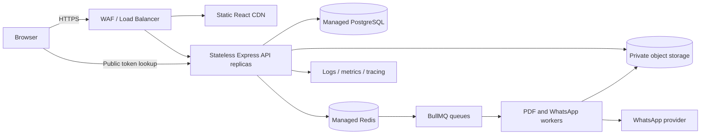

# Deployment plan

## Architecture

## Hosting
- React build on a CDN with TLS and WAF.
- Express API in a managed Kubernetes/container service across at least two availability zones. Keep API stateless; horizontal pod autoscaling on CPU, request latency and in-flight requests.
- PostgreSQL managed HA cluster with automated backups, point-in-time recovery, connection pooling (PgBouncer), read replica for public verification if read volume requires it.
- Redis managed with persistence/replication; BullMQ queues for PDF generation and WhatsApp dispatch.
- PDFs in private object storage, encrypted at rest. Store object key in DB; use short-lived signed URLs after candidate identity verification. Public verification returns minimal metadata, never the PDF or personal contact details.

## Peak capacity and backlog
The stated peak is 500 batches/hour and roughly 30,000 PDFs plus 30,000 WhatsApp messages/hour (about 8.3 of each per second on average, with bursts). Separate queues and worker pools for PDF generation and messaging. Scale workers horizontally based on queue depth and oldest-job age; use bounded concurrency and provider rate limits. Prioritise PDF generation, then enqueue delivery. Apply backpressure and retain jobs durably. Estimate throughput with load tests; do not assume average rate handles bursts.

## Failure handling
- Worker crash: BullMQ stalled-job recovery and retry; idempotent job keys and unique DB constraints prevent duplicate certificates. Alert on repeated failures / oldest job age.
- Redis restart: managed Redis persistence/replication; reconnecting workers; jobs remain durable subject to configured persistence. Alert on queue unavailable and pause API enqueueing with an outbox pattern in production.
- WhatsApp outage: exponential backoff with jitter, dead-letter/failed queue, provider circuit breaker, retry after recovery; do not block approval API requests.
- Slow database: connection pool limits, query timeouts, indexes, slow-query monitoring, bounded retries, read replicas for verification, and graceful 503 under overload.

## Certificate storage and access
Generate immutable PDF artifacts with opaque random IDs; private bucket, server-side encryption, checksum and versioning. Signed download URLs expire quickly and are issued only after authenticated candidate checks. Verification tokens are high entropy and revocable; verification endpoint returns only name/course/issue date/status and reflects cancellation immediately from authoritative DB/cache invalidation.

## Monitoring and alerting
Centralised structured logs with correlation IDs (batchId, candidateId, jobId); OpenTelemetry traces; metrics for API latency/error rate, DB pool saturation, queue depth/age, worker success/retry/failure, PDF generation time, provider response codes and verification latency. Alert on queue age, dead-letter growth, DB saturation, provider outage and unusual cancellation/approval patterns. Audit log is append-only and retained per policy.

## Rough monthly cost (planning estimate, USD)
- API/container compute: $150–300
- PostgreSQL HA + storage/backups: $250–500
- Redis managed: $80–180
- Object storage/CDN/egress: $30–120 (usage dependent)
- Worker compute: $150–350 (peak autoscaling changes this)
- Logs/metrics/WAF/misc: $100–250
- **Indicative total: $760–1,700/month**, excluding WhatsApp provider fees, taxes and unusually high egress. Validate with cloud pricing calculator and measured workload.

Trade-offs: managed services cost more than self-hosting but reduce operational risk; autoscaling workers limits idle spend; PostgreSQL remains the source of truth; Redis is a queue/cache, not the only durable record. Add a transactional outbox to guarantee DB-to-queue publication across crashes before production.
